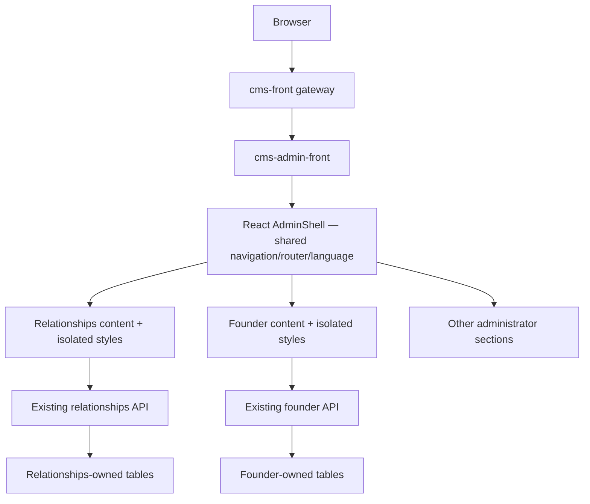

# Unified administrator workspace presentation

Founder and Strategic Relationships render natively inside `AdminShell`. They use the same account, authorization layout, sidebar, language preference and React Router history as other administration domains.

- Route `/admin/strategic-relationships/:view?`: eight scoped views.
- Route `/admin/founder-workspace/:view?`: five scoped views.
- Sidebar owns expandable groups. Metadata in `platform/workspaces/views.ts` contains no domain services or private data.
- `IntegratedWorkspace` mounts each domain using its exported `mountWorkspace(environment)` lifecycle. A ShadowRoot isolates styles and queries, **not security**. There is no iframe or separate document/navigation shell.
- The generic runtime scopes event listeners, aborts requests, clears timers and closes repository channels on disposal. Mounts are repeatable; modules have no import-time side effects.
- Router blockers preserve open drafts across attempted route/history changes. Reload/closing the tab uses the browser's unsaved-work warning. Explicitly leaving does not undo a request already sent to the server.
- Existing application/repository/data contracts remain unchanged. No migration, backend replacement or access expansion is part of this release.
- Learning examples stay memory-only. Entry belongs to the Learning view and leaving resets to personal server data.
- Old public HTML entries redirect to canonical administrator routes. Old administrator hash links normalize to subview paths.
- Founder import confirmation describes replacement of the saved server plan. The obsolete preview-only READ simulation is removed; real Backend permissions still determine write access.

The Backend remains one NestJS application. Domain ownership is independent of presentation placement. Future extraction must also address storage, identity contracts and deployment, rather than copying a folder or retaining duplicated navigation.

The member gateway must route React Router 8 `/__manifest?paths=...` discovery batches to the admin runtime whenever they contain admin paths. Legacy repeated `p` remains supported. Browser verification should traverse the member gateway plus independent admin image, rather than checking only the admin origin.

Integrated content inherits the administrator brand font. Shadow-local font-face declarations are not a reliable font registration boundary; relying on the local Plex family left Arabic glyphs unpainted in Chromium. The shell already registers and loads the shared Arabic/Latin family.
