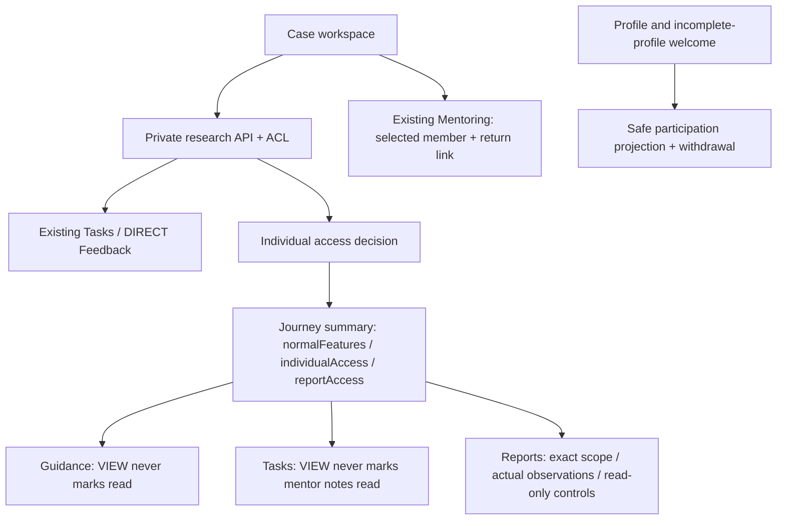

> Historical documentation: Studio P0 was retired on 2026-11-02. These endpoints and grants are no longer available. See [retirement notes](retire-studio-p0.md).

# Individual Experience Studio — واجهة P0

المسار الإداري: `/admin/ux-lab/individual-research`، بصلاحية مستقلة `INDIVIDUAL_RESEARCH` READ/WRITE وACL لكل حالة من الخادم. رابط من UX Lab ومن القائمة الإدارية؛ لا تستخدم صلاحية UX_LAB كبديل للوصول إلى ملاحظات خاصة.

الواجهة ثماني مساحات: Overview / Plan / Sessions / Observations / Interventions / Controls / Timeline / Review. العربية والإنجليزية عبر I18n، ونماذج Modal الموجودة، وملفات CSS محصورة في `.ies`. تعرض الشاشات حالة التقدم الفعلية والإتاحة الاستثنائية كقيمتين منفصلتين.

## حدود الأنظمة



## الملفات

- `src/app/features/admin/individual-research/IndividualResearchPage.tsx`: قائمة وحالة، المحررات، سجل المتابعة والمراجعة، ربط التدخلات، والإتاحة والإلغاء. لا تحتوي محرك رحلة أو تسجيل إنجاز عام.
- `api.ts`: عقود خاصة بالحالة، وAccessDecision/ReportAccess؛ لا تخلط DTO الحالة الخاصة مع DTO مشاركة العضو.
- `individual-research.css`: ألوان ومسافات Admin، بطاقات، تخطيط List/Workspace، وانتقال إلى حالة واحدة على الموبايل.
- `adminAccess.ts` وUser type وAdminAccessPanel وAppSidebar وroutes: تسجيل القسم ومساره وصلاحياته. مسار Individual Research يسبق فحص `/admin/ux-lab` العام.
- `AdminMentoringPage`: `memberId` يختار الشخص، و`researchCase` يحتفظ برابط العودة. لا يضيف صلاحية Mentoring.
- GuidancePage/GuidanceReadingModal: يجمعان الوصول الفعلي من الخادم مع القراءات الحقيقية؛ عرض مبكر لا يحبس العضو في خطوة CV ولا يظهر تأكيد الإكمال.
- TasksPage/TaskDetailModal: VIEW يعطل التعديل والسحب والإضافة والقراءة التلقائية لملاحظات المينتور؛ API مستقل في رفض mutations.
- ReportsPage: cache مميز بالنطاق، اختيار أول تقرير متاح مبكرًا عند غياب Performance، وقرارات العرض من summary واستجابة التقرير. النهائي VIEW لا يعرض زر إكمال الرحلة.
- PerformanceAnalytics/JourneyAnalytics: readOnly مستقل عن Admin Preview، يمنع زر تحديث التحليل ولا يحوّل المعاينة الفردية إلى صلاحية أدمن.
- IndividualParticipationPanel: يجلب projection آمنة فقط، ويسحب الموافقة من Profile أو شاشة الملف غير المكتمل. لا يجلب private case API.

## المحافظة على الخصوصية

تُعزل query keys الخاصة بالحالات بهوية الأدمن. تنظيف cache العام عند الخروج/تغيير الحساب القائم يظل فعالًا. سبب المنح الخاص والملاحظات لا يصلان للمشارك، والمحتوى الموجه له يحتاج تأكيد نشر مستقل. عرض الإرشاد أو المهمة لا يستدعي POST قراءة في VIEW.

الربط من Case إلى Mentoring يخضع لصلاحية MENTORING الموجودة؛ من ليست له تلك الصلاحية يدير التدخل المحدد من Studio عبر خدمة Tasks/Feedback نفسها وتحقق صلاحية Studio في الخادم.

## التشغيل والاختبار

هذه نسخة تطوير غير منشورة، وتحتاج النسخة الخلفية من نفس الميزة وmigration إضافية قبل إتاحتها لاحقًا. لا تغيّر ملف `.env` للإنتاج لمعاينتها.

```sh
npm run typecheck
npm run build
node --test scripts/*checks.mjs
```

`individual-research-browser-checks.cjs` اختبار Playwright اختياري لبيئة محلية معزولة. يحتاج fixtures الناتجة من `cms-back/scripts/seed-individual-research-qa.cjs`، وPlaywright/Chromium مثبتين في بيئة الاختبار؛ لا يضيف حزمًا أو ينشر إعدادات تلقائيًا. يقبل `STUDIO_WEB` و`STUDIO_API` و`FIXTURES_PATH` و`OUTPUT_DIR` و`PLAYWRIGHT_MODULE` و`CHROMIUM_PATH`. يستخدم حسابات تنتهي بـ`@example.invalid` ويرفض النطاقات العامة. أصل HTTP الخاص ببيئة QA يعامل كـsecure context داخل Chromium الاختباري فقط لاختبار UUID؛ الإنتاج HTTPS أصلًا.

تفصيل مصدر الكود، وإعادة الاستخدام، وmigration والعقود والاحتفاظ والنتائج والسيناريو العملي في مستودع الباك:

- `docs/individual-experience-studio-design.md`
- `docs/individual-experience-studio-implementation.md`
- `docs/individual-experience-studio-validation.md`

P1 لم يُنفّذ: خطة عضو تفاعلية تُفتح بالأحداث، مقارنة جلسات طولية، تصدير/ملخص شامل، وروابط متقدمة من Inspector/Observatory. الخطة الحالية خاصة بالمسؤول، بإكمال يدوي مستقل عن الإنجاز العام.
