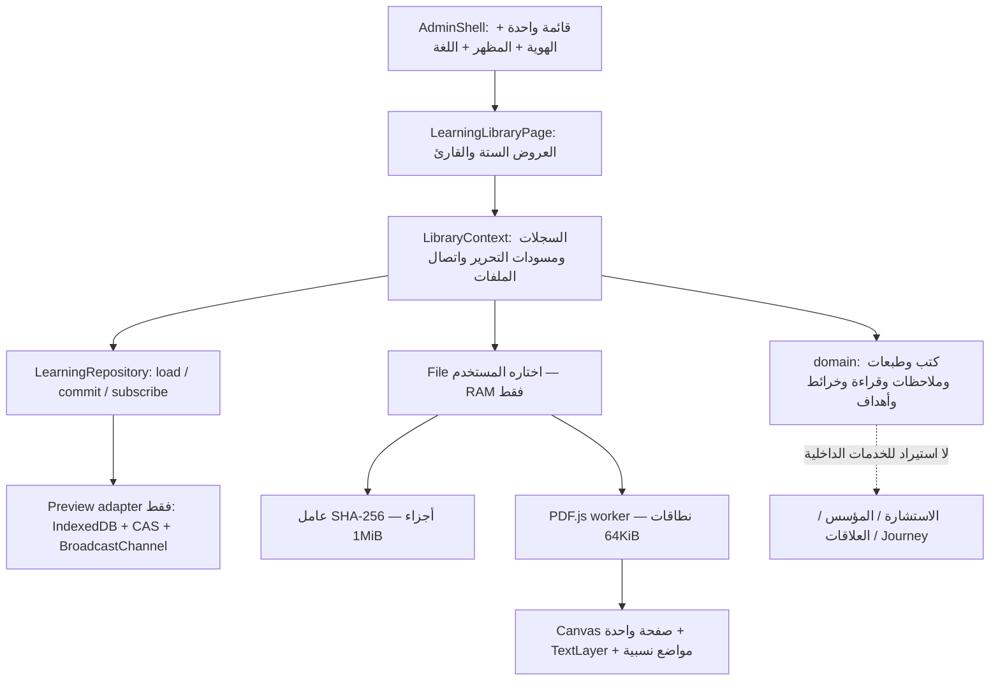

# مكتبة التعلّم — أول تسليم للمراجعة

حالة 4 نوفمبر 2026: معاينة تفاعلية للقارئ ولرحلة التعلّم داخل واجهة الإدارة الأصلية. **هذه ليست مكتبة حساب Production بعد**. خطة المستخدم تنص على مراجعة القارئ والتجربة أولًا قبل توسيع التنفيذ. لم تُطبّق migrations، ولم تتغير الصلاحيات الفعلية أو ملفات الإنتاج.

## التجربة الحالية

`/admin/learning/today` يبدأ بمكتبة فارغة. إضافة كتاب فعل صريح: اختيار PDF محلي، أو اختيار أحد ثلاثة مستندات اختبار مصطنعة. لا بحث في مجلدات المستخدم، ولا استيراد للكتب المرفقة تلقائيًا.

درج الإدارة يفتح ستة عروض لنفس البيانات: قراءتي اليوم، المكتبة، الملاحظات والأفكار، خرائط المعرفة، التطبيق والمراجعة، التقدم والحصيلة. القارئ يفتح داخل نفس الإدارة مع رجوع واضح ووضع تركيز يمكن إنهاؤه بزر أو Escape. لا iframe أو قائمة إدارة بديلة.

- PDF.js 6.5.438 بعمال محليين. قراءة نطاقات الملف المحلي، ورسم الصفحة الحالية فقط، وفهرس/تحديد/بحث عند توفر النص. فصول يدوية عند غياب الفهرس.
- أصل/ليل/ورق دافئ، تكبير وملاءمة عرض وتباين مستقل عن مظهر الإدارة. صور PDF قد تتغير ألوانها؛ زر الأصل متاح. الصفحة الداكنة أصلًا لا تُقلب إلى صفحة ساطعة. تُخفى مرحلة إعادة الرسم لمنع الوميض الساطع.
- الملاحظات العامة وصفحات PDF والتحديد النصي/الموضعي والفصول. الإحداثيات نسب من مساحة الصفحة؛ التكبير لا يعيد كتابة المرجع. ملاحظات الفصل تظهر داخل نطاقه.
- بصمة SHA-256 تدريجية في عامل منفصل. الاسم لا يحدد هوية الملف. إعادة اختيار نفس المحتوى تعيد الاتصال، والملف المختلف يحتاج إضافة طبعة صريحة. ملاحظات كل طبعة تبقى على طبعتها.
- ملفات PDF في RAM فقط. الغلاف المصغر والسجلات في IndexedDB محلي. إلغاء الاتصال أو إعادة التحميل لا يحذف الكتاب أو الملاحظات؛ يُطلب إعادة اختيار الملف. لا يُخزّن PDF داخل IndexedDB.
- القراءة المؤكدة منفصلة عن الزيارة وآخر موضع. اتحاد النطاقات يحسب الصفحات الفريدة، وتقرير الأسبوع يميز الجديد من إعادة القراءة وفق أيام Africa/Cairo.
- الخرائط لا تضيف كتبًا خفية: عقد يختارها المستخدم، روابط موجهة ذات سبب، طي وترتيب اختياري وتحريك بالماوس أو أسهم الكيبورد. الاسم المعروض للمرجع يتبع السجل الأصلي.
- هدف بسؤال ونطاق قراءة، ثم خلاصة وتطبيق ومراجعة مؤرخة. «مراجعة مكتملة» تحتاج نصوص الأدلة الثلاثة، ولا تغيّر التمكن أو Journey.
- تصدير الملاحظات Markdown/JSON، وتصدير تقرير القراءة JSON. تصدير مسودة الملاحظة متاح عند فشل الحفظ. التصدير الكامل/الاستعادة من الحساب جزء من المرحلة التالية.

المسودات تبقى عند رفض الحفظ. الخروج إلى صفحة أخرى يطلب حفظها أو تجاهلها صراحة. النسخ بين نافذتين تستخدم CAS؛ لا كتابة صامتة فوق تعديل أحدث. تُظهر نافذة التحرير نفسها سبب التعارض وزر تحميل التحديث مع إبقاء المسودة.

## الحدود الحالية بوضوح

النسخة المحلية تحفظ بيانات المعاينة **في هذا المتصفح فقط**، تحت حساب اختبار اصطناعي. لا تسجيل دخول Production في خادم المعاينة. حذف بيانات الموقع يحذف هذه السجلات المحلية؛ لا تستخدم المعاينة لحفظ المعرفة الوحيدة دون تصدير الملاحظات المهمة.

لم يُنفذ بعد: API الحساب وPostgreSQL، صلاحيات Backend READ/WRITE والملكية، النسخ الانتقائية للسيرفر والحصة ورفع الأجزاء والاستكمال، inbox SSH/SFTP، نسخ الملفات الاحتياطي والاستعادة، تصدير المكتبة الكامل، وإنشاء مهمة مؤسس عبر عقد تكامل. الرابط الاختياري للمؤسس هنا مرجع فقط. لا OCR أو EPUB أو إعادة تدفق أو تشغيل دون اتصال أو استيراد Miro.

لا يجوز اعتبار نجاح المعاينة تحققًا من أمان مكتبة الحساب أو من رفع/استعادة ملفات Production. هذه بوابات منفصلة موضحة في `learning-library-next.md`.

## المعمارية الحالية



| المجلد/الملف | المسؤولية |
|---|---|
| `domain/types.ts` | الهوية الثابتة للكتاب، الطبعات، المراجع والقراءة والأهداف والخرائط. |
| `domain/model.mjs` | عمليات والتحقق من البيانات واتحاد الصفحات والحصيلة وسلوك الخريطة؛ مستقل عن React وHTTP. |
| `infrastructure/repository.ts` | منفذ الحفظ الذي يسمح باستبدال المعاينة بحفظ الحساب. |
| `infrastructure/preview-repository.ts` | محول مراجعة محلي محاط بشروط DEV؛ لا يتحول إلى fallback صامت لبيانات الحساب. |
| `LibraryContext.tsx` | تحميل البيانات، تسلسل حفظ هذه النافذة، إشعارات التعارض، ملفات الجلسة. |
| `reader/` | بصمة الملف، PDF.js، عرض الصفحة، مواضع الملاحظات وأدوات القراءة. |
| `BookLibrary`, `Notes`, `KnowledgeMaps`, `Goals`, `TodayProgress` | عروض وسياقات عمل تستخدم نفس السجلات. |
| `preview/learning/` | خادم DEV بحساب مصطنع، مولد مستندات اختبار، اختبارات المتصفح. مستبعد من Docker. |
| `scripts/learning-library-checks.mjs` | اختبارات معنى التغطية والطبعات والمراجع والتكرار وحدود الوحدة. |

توجد capability مستقبلية `LEARNING_LIBRARY` في أنواع الفرونت، لكن لا تظهر كصلاحية يمكن منحها من إدارة الأدمنز حاليًا. لا توجد صلاحية Backend فعلية أو تغيير تلقائي لصلاحيات أحد. المسار غير مسجل في بناء Production أو member؛ الـnav ومحول المعاينة يتطلبان DEV وعلم المعاينة.

## تشغيل مراجعة محلية

باستخدام Node 24 وملفات dependencies المثبتة:

```sh
npm ci
NODE_ENV=development node preview/learning/dev-server.mjs
```

يفتح `/admin/learning/today` على منفذ 3000. عند تشغيله في حاوية، انشر المنفذ على loopback فقط. لتوفير الأمثلة الاختبارية، شغّل مولد `generate-samples.cjs` مع Playwright/Chromium واضبط `LEARNING_REVIEW_SAMPLES` إلى مجلد المخرجات؛ ملفات المولد لا تدخل git. يمكن اختيار PDF محلي دون الأمثلة.

```sh
VITE_API_URL=https://api.nawah-project.com NAWAH_LEARNING_PREVIEW=true npm run typecheck
node --test scripts/*checks.mjs
```

اختبارات المتصفح في `preview/learning/*check*.cjs` معدة لحاوية المراجعة الموجودة: Playwright في `/review/tools`، Chromium في `/usr/bin/chromium`، والأدلة في `/evidence`. تستخدم حسابًا اصطناعيًا ولا تتصل ببيانات مستخدمين.

## مراجعة المستخدم المطلوبة قبل مرحلة الحساب

1. افتح مثال PDF نصي، وانتقل إلى صفحة وسط الكتاب. قارن الليل والأصل والورق؛ جرّب وضع التركيز.
2. حدد نصًا أو موضعًا، اكتب ملاحظة، ثم كبّر الصفحة. ألغِ اتصال الملف وأعد اختياره باسم مختلف؛ راجع بقاء الملاحظة.
3. أكد نطاقين متداخلين، ثم راجع الحصيلة. جرب فصلًا من المنتصف دون اعتبار ما قبله مقروءًا.
4. أنشئ خريطة سؤال، أضف كتابًا وفكرة ورابطًا بسبب واضح، وجرّب الطي والتحريك.
5. دوّن سؤال تعلّم وخلاصة وتجربة تطبيق ومراجعة. هل يخدم ذلك طريقة عملك الفعلية؟

بعد مراجعة هذه التجربة نثبت التعديلات المطلوبة ثم ننفذ الحساب والملفات والتكامل والنشر؛ لا ننسخ خادم المعاينة وحسابه إلى الإنتاج.

المراجع التقنية: [PDF.js](https://mozilla.github.io/pdf.js/api/draft/module-pdfjsLib.html)، [حدود تحويل PDF في calibre](https://manual.calibre-ebook.com/conversion.html#pdfconversion). هذه المعاينة لا تحول الكتب إلى EPUB.

## اعتماد المعاينة وتنفيذ الحساب — 4 نوفمبر2026

اعتمد المستخدم المعاينة وطلب إكمال الخطة. المرحلة التالية منفذة في المصدر:
محول حساب يعتمد APIs المصادقة والحفظ بالخادم بدل IndexedDB، ونسخة سيرفر اختيارية
بمكونات رفع/إيقاف/استكمال/إزالة، واستيراد خاص من inbox، وتصدير/دمج سجلات المكتبة.
القارئ يفتح النسخة المحفوظة على الحساب بنطاقات HTTP، دون تحميل الكتاب كله مسبقًا.
ملفات CMaps/fonts/wasm للقارئ تُضمّن في بناء الإدارة وبنفس أصل الموقع.

تبقى معاينة DEV منفصلة عند علمها الصريح، ولا تكون fallback عند فشل حفظ الحساب.
يمكن تصدير بيانات المعاينة بصيغةJSON ثم اختيار استعادتها صراحةً في مكتبة الحساب؛
ملفات PDF نفسها تظل محلية حتى تختار الرفع. لا نقل تلقائي ولا استيراد للكتب المرفقة.

بطاقة الهدف تربط مهمة موجودة أو تفتح نموذج إنشاء مهمة في المؤسس بتواريخ وجهد ومسار
تختارهم. العملية تستخدم عقد المؤسس العام، ولا تنسخ الخطة أو تنجز المهمة تلقائيًا.
تحتاج صلاحية الكتابة في المكتبة وفي المؤسس للإنشاء. بقاء الخدمات منشورة والتحقق
من النسخ الاحتياطي والبوابات الأمنية يثبت في تقرير الإصدار الفعلي؛ مصدر الفرع وحده
لا يثبت أن النشر اكتمل.
